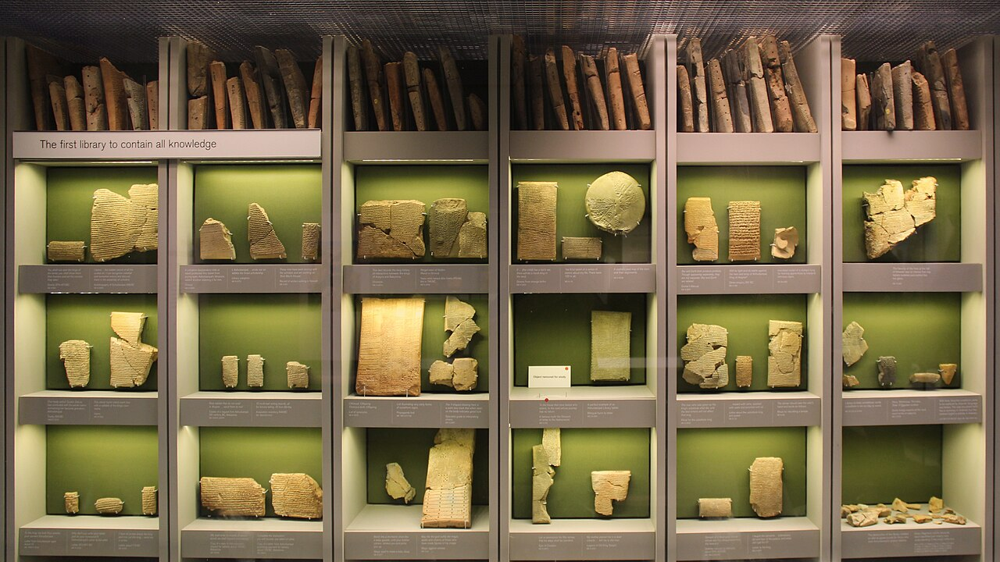
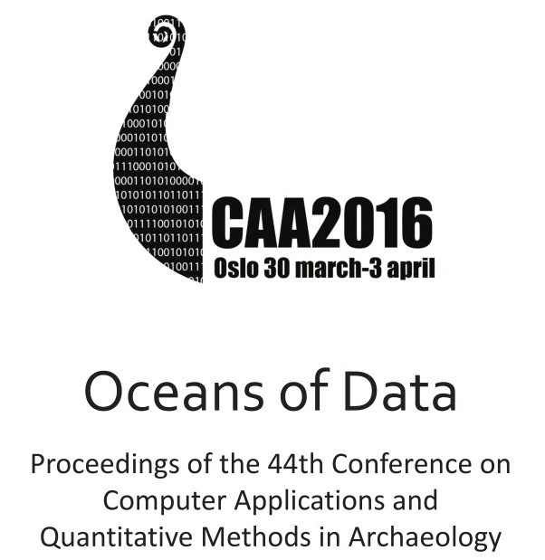
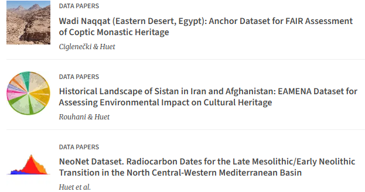

```{r, echo=FALSE}
library(dplyr)
library(kableExtra)
```


# Introduction

## "Collection(s)" : une définition

<br><br>
"Ensemble d’objets de même sorte que l’on réunit volontairement dans un esprit de curiosité, ou pour leur valeur artistique, scientifique ou documentaire."&nbsp; &nbsp; &nbsp; <div class="captiontext">-- Dictionnaire de l'Académie française, 9<sup>e</sup> édition[^1], 2024</div>

[^1]: <https://www.dictionnaire-academie.fr/article/A9C2933>


## "Collection(s)" : une augmentation

:::: {.columns}

::: {.column width="60%"}

<div class="captiontext"> Bibliothèque d'Assurbanipal (1500-539 BCE) au <em>British Museum</em>.<br> By Gary Todd - https://www.flickr.com/photos/101561334@N08/36562516345/, CC0, https://commons.wikimedia.org/w/index.php?curid=91138912</div>
:::

::: {.column width="40%"}
<br>
<small>
<table style="border-collapse: collapse; width: 100%;">
  <thead>
    <tr>
      <th style="border: 1px solid black;">objet</th>
      <th style="border: 1px solid black;">stockage</th>
      <th style="border: 1px solid black;">BCE/AD</th>
    </tr>
  </thead>
  <tbody>
    <tr>
      <td style="border: 1px solid black;">tablette de Fara</td>
      <td style="border: 1px solid black;">150 octets</td>
      <td style="border: 1px solid black;">2600 BCE</td>
    </tr>
    <tr>
      <td style="border: 1px solid black;">papyrus d’Ani</td>
      <td style="border: 1px solid black;">400 octets</td>
      <td style="border: 1px solid black;">1500 BCE</td>
    </tr>
    <tr>
      <td style="border: 1px solid black;">livre de 200 pages</td>
      <td style="border: 1px solid black;">150 ko</td>
      <td style="border: 1px solid black;">1450 AD</td>
    </tr>
    <tr>
      <td style="border: 1px solid black;">disque vinyle</td>
      <td style="border: 1px solid black;">50 Mo</td>
      <td style="border: 1px solid black;">1950 AD</td>
    </tr>
    <tr>
      <td style="border: 1px solid black;">CD</td>
      <td style="border: 1px solid black;">800 Mo</td>
      <td style="border: 1px solid black;">1985 AD</td>
    </tr>
    <tr>
      <td style="border: 1px solid black;">Clé USB-C</td>
      <td style="border: 1px solid black;">1 To</td>
      <td style="border: 1px solid black;">2020 AD</td>
    </tr>
    <tr>
      <td style="border: 1px solid black;">SSD professionnel</td>
      <td style="border: 1px solid black;">120 To</td>
      <td style="border: 1px solid black;">2025 AD</td>
    </tr>
  </tbody>
</table>
</small>
:::
::::

## Le mouvement _collection-as-data_ (1/2)

<br>
<table>
  <thead>
    <tr>
      <th scope="col"></th>
      <th scope="col">avant</th>
      <th scope="col">après</th>
    </tr>
  </thead>
  <tbody>
    <tr>
      <th scope="row">objet</th>
      <td>artefacts physiques</td>
      <td>data</td>
    </tr>
    <tr>
      <th scope="row">paradigme</th>
      <td>qualitatif/expertise</td>
      <td>quantitatif/généraliste</td>
    </tr>
    <tr>
      <th scope="row">méthode</th>
      <td>hypothético-déductif</td>
      <td>empirico-inductif</td>
    </tr>
    <tr>
      <th scope="row">cible</th>
      <td>utilisateur</td>
      <td>machine</td>
    </tr>
    <tr>
      <th scope="row">interface</th>
      <td>UX</td>
      <td>API</td>
    </tr>
  </tbody>
</table>

<style>
  table { border-collapse: collapse; font-family: sans-serif; }
  th, td { border: 1px solid #333; padding: 6px 14px; text-align: center; }
  thead th { background: #f2f2f2; }
</style>
<br>
<div class="captiontext"><em>collection-as-data</em> : avant / après</div>


## Le mouvement _collection-as-data_ (2/2)

<center>

```{=html}
<div class="iframe-figure"
     style="width: 1200px; height: 500px; overflow: hidden;">
  <iframe
    src="https://collectionsasdata.github.io/"
    title="collection-as-data"
    style="
      width: 1714px;
      height: 786px;
      border: none;
      transform: scale(0.9);
    ">
  </iframe>
</div>
```
<div class="captiontext"><https://collectionsasdata.github.io/></div>

</center>

# Datafication: un monde de _data_

## _An Ocean of data_ (en archéologie)

<center>



</center>


## "Data", une définition

<br><br>
"Reinterpretable representation of information in a formalized manner suitable for communication, interpretation or processing."&nbsp; &nbsp; &nbsp; <div class="captiontext">-- ISO/IEC 2382:2015 (_Information technology — Vocabulary_)[^2], 2015</div>

[^2]: Représentation réinterprétable d'une information, sous une forme conventionnelle adaptée à sa communication, son interprétation ou son traitement.

## La datafication du monde

<br><br>
"The drive towards <b>datafication</b> is rooted in a belief in the capacity of data to represent social life, sometimes better or more objectively than pre-digital (human) interpretations"&nbsp; &nbsp; &nbsp; <div class="captiontext"> -- Hintz, Arne; Lina Dencik; Karin Wahl-Jorgensen, 2019[^3]</div>

[^3]: La tendance à la <b>datafication</b> repose sur la conviction que les données ont la capacité de représenter la vie sociale, parfois mieux ou plus objectivement que les interprétations (humaines) pré-numériques.

# Un peu de recherche dans un monde de (data) brutes

## Le _gold standard_ de la reproductibilité

<br>

<table style="width: 100%; table-layout: fixed; border-collapse: collapse; font-size: 25px;">
  <colgroup>
    <col style="width: 35%;">
    <col style="width: 30%;">
    <col style="width: 35%;">
  </colgroup>
  <thead>
    <tr>
      <th>Couche sémantique (<code>texte libre</code>)</th>
      <th>Couche logique (<code>JSON</code>)</th>
      <th>Couche algorithmique (<code>Python</code>)</th>
    </tr>
  </thead>
  <tbody>
    <tr>
      <td>
        Une hache en bronze, datée de l'âge du Bronze moyen,
        découverte dans un contexte funéraire.
      </td>
      <td>
        <pre style="font-size: 20px;"><code style="font-size: inherit;">json_data = {
  "id": "OBJ_001",
  "type": "hache",
  "materiau": "bronze",
  "periode": "Bronze moyen",
  "contexte": "funéraire"
}</code></pre>
      </td>
      <td>
       <pre style="font-size: 20px;"><code style="font-size: inherit;" class="language-python">import json

objet = json.loads(json_data)

if objet["materiau"] == "bronze":
    print(objet["id"])</code></pre>
      </td>
    </tr>
  </tbody>
</table>


$$
\underbrace{\text{Data}}_{\text{C. sémantique}}
\;\times\;
\underbrace{\text{Code-as-data}}_{\text{C. logique + C. algorithmique}}
\;\xrightarrow{\text{FAIR}}\;
\text{Reproductibilité}
$$


## Une architecture pour les controller toutes

```{=html}
<div class="iframe-figure">
  <iframe width="1200" height="550"
          src="https://iramat-apps.cnrs.fr/portal/html/lod/iramat_workflow_interactive.html"
          title="RDI Iramat"></iframe>
</div>
```

# Collectioner à l'Iramat

## Collections numismatiques à l'IRAMAT

```{=html}
<div class="iframe-figure">
  <iframe width="1200" height="500"
          src="https://iramat-apps.cnrs.fr/numishare/almacir/"
          title="Numishare ALMACIR"></iframe>
</div>
```
<div class="captiontext">La collection de monnaies 'Almacir' (Al-Andalus - MAghreb. CIRculation) sur la pile logicielle <a href="https://numismatics.org/resources/" target="_blank">Numishare</a>
</div>


# Chronologie des publications


## Paroles d'expert: l'article de recherche

"_In God we trust. All others must bring data_."&nbsp; &nbsp; &nbsp; <div class="captiontext">-- W. Edwards Deming</div><br>

:::: {.columns}

::: {.column width="50%"}


:::

::: {.column width="50%"}

<center>


```{=html}
<div class="iframe-figure" style="width:100%; aspect-ratio:16/9;">
  <iframe
    src="https://commons.wikimedia.org/wiki/File:Academics_expose_corruption_in_Grievance_Studies.webm?embedplayer=true&start=9"
    title="Academics expose corruption in Grievance Studies"
    loading="lazy"
    allow="autoplay; fullscreen; picture-in-picture"
    allowfullscreen
    style="width:100%; height:100%; border:0; display:block;">
  </iframe>
</div>
```
<div class="captiontext">James A. Lindsay, Helen Pluckrose et Peter Boghossian, les auteurs du canular 'Sokal au carré'.</div>

</center>
:::

::::


## Paroles d'expert: l'article de recherche {data-visibility=hidden}


:::: {.columns}

::: {.column width="60%"}
<br>
"_In God we trust. All others must bring data_."&nbsp; &nbsp; &nbsp; <div class="captiontext">-- W. Edwards Deming</div>
<br>

:::

::: {.column width="40%"}

<center>


<div class="captiontext">James A. Lindsay et Helen Pluckrose, deux des trois auteurs du canular 'Sokal au carré'. Par Mike Nayna, CC BY 3.0, https://commons.wikimedia.org/w/index.php?curid=73725731</div>

</center>
:::

::::


## Articles de données et nanopublications

<table style="width: 100%; table-layout: fixed; border-collapse: collapse; font-size: 30px; text-align: center;">
  <colgroup>
    <col style="width: 30%;">
    <col style="width: 30%;">
    <col style="width: 35%;">
  </colgroup>
  <thead>
    <tr>
      <th scope="col" colspan="3" style="text-align: center;">
        <b>Science</b> ouverte
      </th>
    </tr>
  </thead>
  <tbody>
    <tr>
      <td style="text-align: center; vertical-align: middle;">
        <b>Données</b> ouvertes
      </td>
      <td style="text-align: center; vertical-align: middle;">
        <b>Code</b> open source
      </td>
      <td style="text-align: center; vertical-align: middle;">
        <b>Publication</b> open access
      </td>
    </tr>
  </tbody>
</table>
<div class="captiontext">Piliers de la Science ouverte</div>
<br>

:::: {.columns}

::: {.column width="55%"}

<center>


<div class="captiontext">Exemples de papiers de données dans le _Journal of open archaeology data_</div>

</center>

:::

::: {.column width="45%"}
<p style="font-size: 30px;">
**Nanopublication** :<br>
Unité minimale d'information[^6] publiée selon un format structuré, permettant son identification, son interopérabilité et sa réutilisation. <br><br>
<u>Exemple</u> : définition de la période '<a href="http://n2t.net/ark:/99152/p0m64tdd5n9" target="_blank">Islamic, Early [Umayyad/Abbasid]</a>' dans le _gazetteer_ PeriodO
</p>
:::

::::

[^6]: i.e. une seule affirmation scientifique 

# Enjeux pour les collectionneurs du XXI<sup>e</sup> siècle


## Programmation lettrée

<br>
<a href="https://colab.research.google.com/drive/1VjwnkV_C53aSnlbnPMNpM4EXJVEUjHU6#scrollTo=ESimU4fjpySz"
   target="_blank"
   rel="noopener noreferrer">
  Ouvrir le Jupyter NB
</a>

## IaaS et fédération de données (_data federation_)

# A CLASSER

Research Software engineer
FAIR