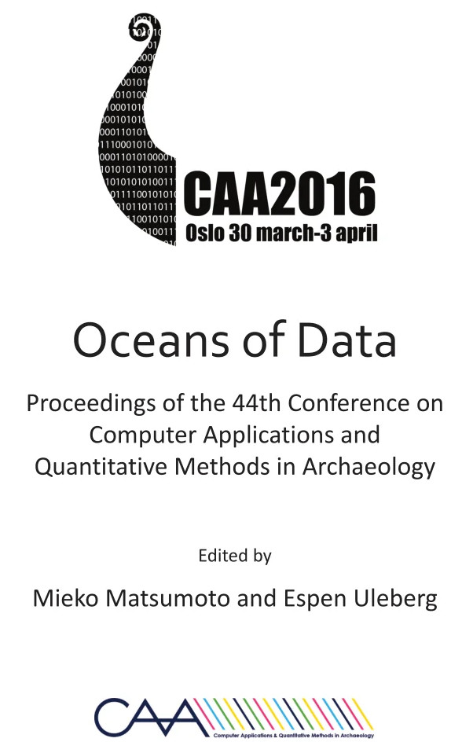

```{r, echo=FALSE}
library(dplyr)
library(kableExtra)
```


# Introduction

## "Collection(s)" : une définition

<br><br>
"Ensemble d’objets de même sorte que l’on réunit volontairement dans un esprit de curiosité, ou pour leur valeur artistique, scientifique ou documentaire."&nbsp; &nbsp; &nbsp; <div class="captiontext">-- Dictionnaire de l'Académie française, 9<sup>e</sup> édition[^1], 2024</div>

[^1]: <https://www.dictionnaire-academie.fr/article/A9C2933>


## "Collection(s)" : une augmentation

:::: {.columns}

::: {.column width="60%"}

<div class="captiontext"> Bibliothèque d'Assurbanipal (1500-539 BCE) au <em>British Museum</em>.<br> Crédit: Gary Todd</div>
:::

::: {.column width="40%"}
<br>
<small>
<table style="border-collapse: collapse; width: 100%;">
  <thead>
    <tr>
      <th style="border: 1px solid black;">objet</th>
      <th style="border: 1px solid black;">stockage</th>
      <th style="border: 1px solid black;">BCE/AD</th>
    </tr>
  </thead>
  <tbody>
    <tr>
      <td style="border: 1px solid black;">tablette de Fara</td>
      <td style="border: 1px solid black;">150 octets</td>
      <td style="border: 1px solid black;">2600 BCE</td>
    </tr>
    <tr>
      <td style="border: 1px solid black;">papyrus d’Ani</td>
      <td style="border: 1px solid black;">400 octets</td>
      <td style="border: 1px solid black;">1500 BCE</td>
    </tr>
    <tr>
      <td style="border: 1px solid black;">livre de 200 pages</td>
      <td style="border: 1px solid black;">150 ko</td>
      <td style="border: 1px solid black;">1450 AD</td>
    </tr>
    <tr>
      <td style="border: 1px solid black;">disque vinyle</td>
      <td style="border: 1px solid black;">50 Mo</td>
      <td style="border: 1px solid black;">1950 AD</td>
    </tr>
    <tr>
      <td style="border: 1px solid black;">CD</td>
      <td style="border: 1px solid black;">800 Mo</td>
      <td style="border: 1px solid black;">1985 AD</td>
    </tr>
    <tr>
      <td style="border: 1px solid black;">Clé USB-C</td>
      <td style="border: 1px solid black;">1 To</td>
      <td style="border: 1px solid black;">2020 AD</td>
    </tr>
    <tr>
      <td style="border: 1px solid black;">SSD professionnel</td>
      <td style="border: 1px solid black;">120 To</td>
      <td style="border: 1px solid black;">2025 AD</td>
    </tr>
  </tbody>
</table>
</small>
:::
::::


# Datafication: un monde de _data_

## _An Ocean of data_ (en archéologie)

<center>



</center>


## "Data", une définition

<br><br>
"Reinterpretable representation of information in a formalized manner suitable for communication, interpretation or processing."&nbsp; &nbsp; &nbsp; <div class="captiontext">-- ISO/IEC 2382:2015 (_Information technology — Vocabulary_)[^2], 2015</div>

[^2]: Représentation réinterprétable d'une information, sous une forme conventionnelle adaptée à sa communication, son interprétation ou son traitement.

## vers la datafication

Digitalisation -> CaD

# Un peu de recherche dans un monde de (data) brutes

## Le _gold standard_ de la reproductibilité

data + code (code-as-data) -> résultat

## Une architecture pour les controller toutes

RDI + IaaS + _distributed_ + _aggregated_

# Les monnaies, des artefacts dignes d'être collectionnés

Spécificité des monnaies (numismatique) -> ...

# A CLASSER

Research Software engineer
FAIR